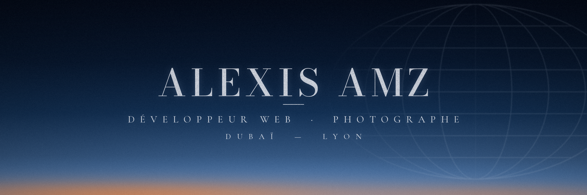

# Alexis AMZ DA CRUZ

Développeur web et photographe freelance, entre **Lyon** et **Dubaï**.
Je construis des sites sur-mesure et je photographie des événements, des voitures et des portraits.

## Ce que je fais

- **Sites web sur-mesure** : vitrines et boutiques en Next.js, rapides, accessibles et bien référencés.
- **Photographie** : événement, automobile et moto, portrait.

## Projets

| Projet | Ce que c'est | Site | Code |
|---|---|---|---|
| **StreamPulse** | Extension Twitch et Kick : alertes de live, points de chaîne, Drops | [streampulse.fr](https://www.streampulse.fr) | [Chrome](https://github.com/AlexisAMZ/streampulse-extension) · [Firefox](https://github.com/AlexisAMZ/streampulse-firefox) |
| **StreamPulse Clips** | Application web StreamPulse Clips | [Voir le site](https://streampulse-clips-web.vercel.app) | Privé |
| **Belka'Coiff** | Prise de rendez-vous pour un salon de coiffure à Lyon | [belkacoiff.fr](https://belkacoiff.fr) | Privé |
| **DCZ Imports** | Site web | [Voir le site](https://dcrz-imports.vercel.app) | Privé |
| **Insta Stalker** | Suivi des abonnés Instagram et des désabonnements, en lecture seule | [Voir le site](https://amztracker-alexisamz.vercel.app) | [Code](https://github.com/AlexisAMZ/insta-stalker) |
| **AgentRouter pour VS Code** | Extension VS Code et Cursor pour AgentRouter | | [Code](https://github.com/AlexisAMZ/agentrouter-vscode) |
| **Claude Presenter Video** | Skill Claude Code : une vidéo de présentateur IA à partir d'un script et d'une photo | | [Code](https://github.com/AlexisAMZ/claude-presenter-video) |
| **Mon portfolio** | Ce site, en Next.js | [alexisamz.com](https://alexisamz.com) | Privé |

## Outils

**Langages**

**Frameworks et services**

## Me contacter

- Site : [alexisamz.com](https://alexisamz.com)
- E-mail : [contact@alexisamz.com](mailto:contact@alexisamz.com)
- Instagram : [@alexisamz](https://instagram.com/alexisamz)
- Photos : [Unsplash @alexisamz](https://unsplash.com/@alexisamz)
